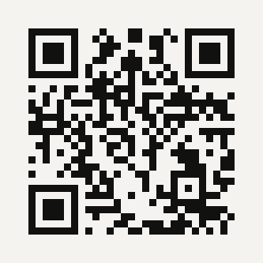

# Sober Days

A quiet sobriety day counter. It shows how long you have been sober, the next milestone, and one quote, question or practice for each day. There is a one-minute guided breathing screen for hard moments, and a small celebration you open by holding a button.

**Open the app: https://okeyokey319.github.io/sober-days/**



Scan the code with the phone camera to open it.

## Install on Android

1. Open the link in Chrome.
2. Menu (⋮) → **Install app** (or **Add to Home screen**).

It then opens full screen from its own icon and works offline.

## Privacy

Everything stays on the device. The start date is kept in the browser's local storage; there are no accounts, no analytics and no network calls beyond loading the app itself.

## Development

Plain HTML, CSS and JavaScript, no build step. Serve the folder with any static server, for example:

```bash
python -m http.server 8000
```

and open http://localhost:8000. Pushing to `main` publishes the app through GitHub Pages.

- [NOTES.md](NOTES.md): product decisions and ideas for later
- [CLAUDE.md](CLAUDE.md): project guide for AI assistants
